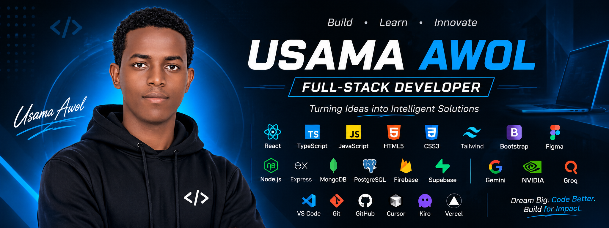

<h1 align="center">Usama Awol</h1>
<h3 align="center">Full-Stack Developer | AI Integration | Progressive Web Apps</h3>

<a href="https://usamaawol.pro.et">Portfolio</a> · <a href="https://www.linkedin.com/in/usama-awol">LinkedIn</a> · <a href="https://t.me/UATech1">Telegram</a>

---

## About Me

Full-Stack Developer based in Ethiopia with **2 years of hands-on development experience** building modern web applications and digital products.

I work across the product lifecycle: user interfaces, backend services, databases, AI integrations, and deployment. I have also built **Progressive Web Apps (PWAs)**, including installable and offline-capable experiences.

- Collaborate with developers and contribute in team-based build environments, including the **Cursor Hackathon**.
- Connect AI services to practical product features and workflows.
- Use AI-assisted tools with a focus on architecture, problem-solving, and understanding the code.
- Adapt quickly, communicate clearly, and turn ideas into usable products.

## What Makes My Approach Different

**End-to-end perspective** — I consider the full product, not just an isolated screen or feature.

**PWA experience** — I build web experiences that can be installable, responsive, and useful with limited connectivity.

**AI + full-stack** — I combine application development with model APIs and AI-powered workflows.

**Collaborative building** — I value shared ownership, feedback, and learning with a team.

## Technology Stack

### Frontend & Design

### Backend & Databases

### AI Integration & APIs

### Developer Tools

### Deployment & Package Management

## Selected Work

- [Amanah Library System — Live Demo](https://amanahkeeper.vercel.app/)
- [AI Compass — Live Demo](https://aicompass-phi.vercel.app/)
- ShopKeepers
- Golden Akhira Builder
- Type Racer
- Progressive Web Applications
- Cursor Hackathon collaboration

I keep only selected repositories public. More of my work and experience is available through my portfolio.

## Languages

Afaan Oromo · English · Amharic · Arabic

## Currently Exploring

- AI-powered application development and intelligent automation.
- Chatbot AI integration and AI-powered features.
- Mobile application development with **Flutter** and **Kotlin**.
- Building cross-platform and native mobile experiences.
- Combining AI capabilities with full-stack applications and Progressive Web Apps (PWAs).

## Connect

- Portfolio: https://usamaawol.pro.et
- LinkedIn: https://www.linkedin.com/in/usama-awol
- GitHub: https://github.com/usamaawol
- Telegram: https://t.me/UATech1

---

## GitHub Activity

  
  

  

  <picture>
    <source media="(prefers-color-scheme: dark)" srcset="https://raw.githubusercontent.com/usamaawol/usamaawol/output/github-contribution-grid-snake-dark.svg" />
    <source media="(prefers-color-scheme: light)" srcset="https://raw.githubusercontent.com/usamaawol/usamaawol/output/github-contribution-grid-snake.svg" />
    
  </picture>

<i>Build with purpose. Learn continuously. Create meaningful impact.</i>

